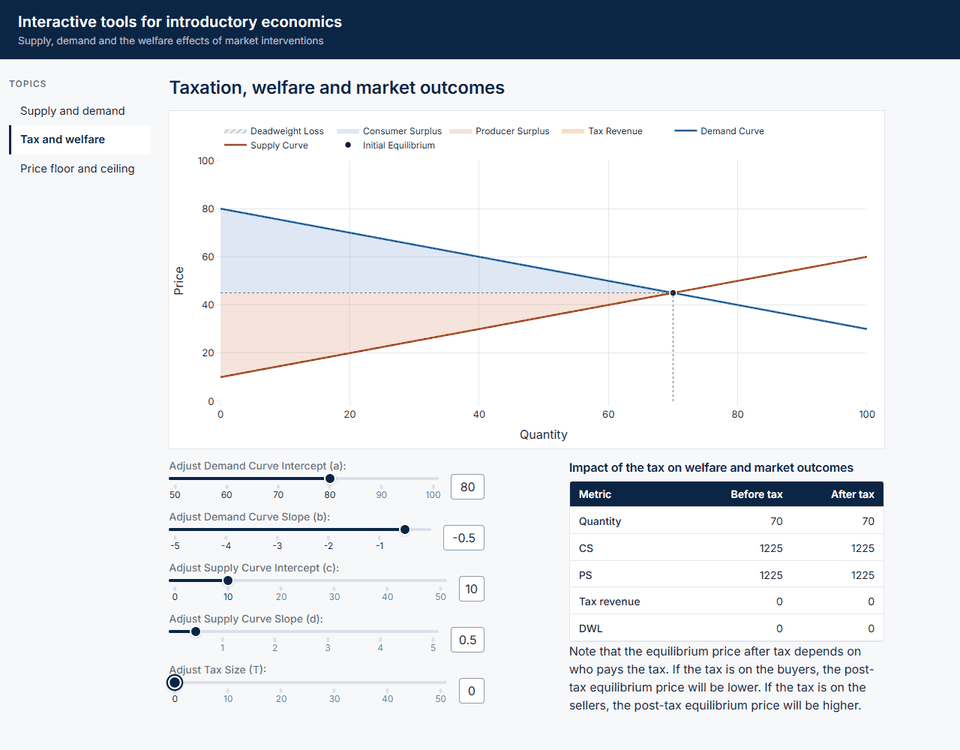

# Interactive tools for introductory economics

An interactive web app for exploring the supply and demand model. Move the sliders and see the
market equilibrium, consumer and producer surplus, tax revenue and deadweight loss update
instantly, both on the graph and in a summary table.

**Live app:** https://econ-interactive-tools.onrender.com



## What's inside

Every page uses the linear supply and demand model

```
Demand:  P = a + bQ    (b < 0)
Supply:  P = c + dQ    (d > 0)
```

| Page | What you can do |
|---|---|
| **Supply and demand** | Change the intercepts and slopes of both curves and watch the equilibrium price, quantity, consumer surplus and producer surplus respond. |
| **Tax and welfare** | Add a per-unit tax and see how it splits the market: the gap between buyer and seller prices, the tax revenue collected, and the deadweight loss created. A table compares outcomes before and after the tax. |
| **Price floor and ceiling** | Set a minimum price above equilibrium, or a maximum price below it, and compare surplus and deadweight loss with the unregulated market. |

Hover over any shaded area of a graph to see its value.

## Running locally

Requires Python 3.12.

```bash
git clone https://github.com/mydam169/econ-interactive-tools.git
cd econ-interactive-tools

python -m venv .venv
# Windows
.venv\Scripts\activate
# macOS / Linux
source .venv/bin/activate

pip install -r requirements.txt
python app.py
```

Then open http://127.0.0.1:8050 in your browser.

## Project structure

```
app.py                  App entry point: header, sidebar navigation and page container
assets/style.css        Page styling (loaded automatically by Dash)
pages/
  p1_equilibrium.py     Supply and demand page
  p2_tax_welfare.py     Tax and welfare page
  p3_price_fixing.py    Price floor and ceiling page
  appModules.py         Model classes: LinearDSModel, TaxModel, PriceFloor, PriceCeiling
  theme.py              Shared colors, chart template and table style
  markdown_texts.py     Text content for the pages
docs/demo.gif           Demo animation used in this README
```

The economics lives in `pages/appModules.py`, separate from the pages, so the model classes can
be reused or tested on their own.

## Built with

[Dash](https://dash.plotly.com/) and [Plotly](https://plotly.com/python/) for the app and
graphs, [Dash Bootstrap Components](https://dash-bootstrap-components.opensource.faculty.ai/)
for layout, and NumPy and pandas for the calculations. In production the app is served with
[gunicorn](https://gunicorn.org/) (`gunicorn app:server`) on [Render](https://render.com/).
